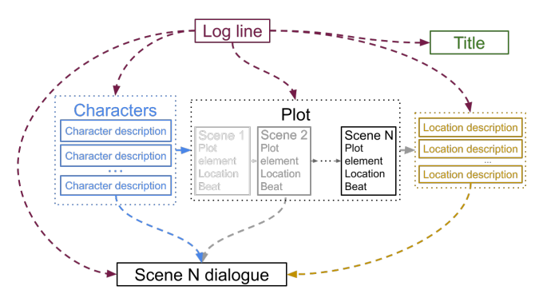
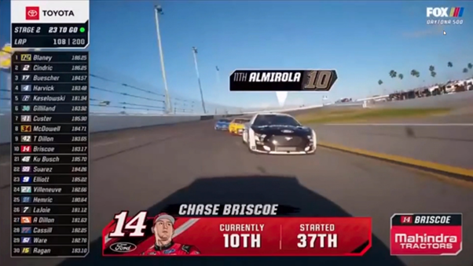
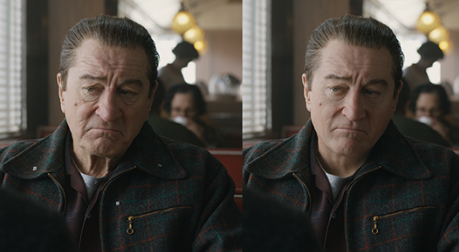

<header class="academic-header" markdown="1">
<h1 class="academic-title">Artificial Intelligence Applications in TV Industry Workflow</h1>
<div class="academic-authors">
<div class="academic-author">
<div class="author-name">Alan L. V. Guedes</div>
<div class="author-inst">University of Reading</div>
</div>
</div>
<div class="academic-conference">WTVDI 2025</div>
<div class="academic-links" markdown="span">
<a class="academic-link-btn" href="https://doi.org/10.5753/webmedia_estendido.2025.16796">
:simple-doi: <span>DOI</span>
</a>
<a class="academic-link-btn" href="assets/pdfs/main.pdf">
:lucide-download: <span>Pre-print</span>
</a>
<a class="academic-link-btn" href="slides/">
:lucide-presentation: <span>Slides</span>
</a>
<a class="academic-link-btn" href="https://github.com/alanlivio/paper-webmedia25-tv-workflow-ai">
:simple-github: <span>Paper Repo</span>
</a>
</div>
</header>

<div class="abstract-container" markdown="1">
<div class="abstract-inner" markdown="1">

## Abstract

The TV industry is going through a major change due to consumers' need for high-quality, diverse, and customized content. This leads to increased production costs while production timelines shrink. To deal with these challenges, the industry is leveraging the use of Artificial Intelligence to improve and optimize its processes. This paper gives a summary of how AI is being used in existing literature and publicly available use cases. Unlike prior works, we place these applications in the perspective of the TV industry workflow of pre-production, production, post-production, and distribution.

</div>
</div>

## Overview

We organize current Artificial Intelligence applications in broadcast and streaming television according to the four-stage production workflow defined by Owens: **Pre-Production**, **Production**, **Post-Production**, and **Distribution**.

- **Pre-Production**: Automated journalism (BBC, NHK Smart Production, Heliograf) and hierarchical LLM scriptwriting (`Dramatron`).
- **Production**: Robotic camera auto-framing, live sports player tracking, and real-time telemetry and AR overlays (Vizrt, F1/AWS).
- **Post-Production**: Spatio-temporal super-resolution (SD/HD to 4K/8K), archive colorization, denoising, synthetic media generation, and neural lip-sync (`TrueSync`).
- **Distribution**: Personalized scheduling (BBC iPlayer), hybrid recommendation engines, multimodal voice assistants, and targeted advertising.

## Selected Applications

<table>
  <tbody>
    <tr>
      <td align="center" width="50%">
        <br />
        Hierarchical story generation in <strong>Dramatron</strong> (Pre-Production)
      </td>
      <td align="center" width="50%">
        <br />
        Real-time live sports visual analysis and tracking with <strong>Vizrt</strong> (Production)
      </td>
    </tr>
    <tr>
      <td align="center" width="50%">
        <br />
        AI-powered visual effects de-aging in <em>The Irishman</em> (Post-Production)
      </td>
      <td align="center" width="50%">
        <br />
        <strong>Flawless TrueSync</strong> neural lip-synchronization for multilingual adaptation (Post-Production / Distribution)
      </td>
    </tr>
  </tbody>
</table>

## Citation

```bibtex
@inproceedings{webmedia_estendido,
 author = {Alan Guedes},
 title = { Artificial Intelligence Applications in TV Industry Workflow},
 booktitle = {Anais Estendidos do XXXI Simpósio Brasileiro de Sistemas Multimídia e Web},
 location = {Rio de Janeiro/RJ},
 year = {2025},
 keywords = {},
 issn = {2596-1683},
 pages = {265--270},
 publisher = {SBC},
 address = {Porto Alegre, RS, Brasil},
 doi = {10.5753/webmedia_estendido.2025.16796},
 url = {https://sol.sbc.org.br/index.php/webmedia_estendido/article/view/38182}
}
```

<footer class="academic-footer md-typeset">
<p>Built with <a href="https://zensical.org" rel="nofollow">Zensical</a> based on <a href="https://research-template.roman.technology" rel="nofollow">Roman Hauksson-Neill's project page template</a></p>
</footer>
