<!-- _class: invert -->
<!-- _backgroundColor: #46afa0 -->
<!-- _paginate: skip -->

# Artificial Intelligence Applications   in TV Industry Workflow  

**Alan Guedes** `a.guedes@reading.ac.uk`

---

# Who I am?

I am currently Computer Science Lecturer and supervise a CS PhD student.

My research interest lies in Computer Vision & GenAI

I enjoy interdisciplinary, e.g., collaborate with NHM, MERL, UoR Synthetic Media, UoR Digital Humanities COP

---

## Agenda

- Context of AI in TV Industry  
- AI applications
- Final Remarks

---

<!-- _class: invert -->
<!-- _paginate: false -->

# Context of AI in TV Industry

---

# Streaming Era bring data richness

 

## This **data richness enabled AI Transformation** in TV Industry

---

## Added Values by AI

## Added Values of AI Transformation

<table style="width:100%; table-layout:fixed; border-collapse:collapse; text-align:left; font-size:0.95em;">
  <thead>
    <tr>
      <th style="width:50%; border-bottom:1px solid #ddd;">Operational Efficiency</th>
      <th style="width:50%; border-bottom:1px solid #ddd;">Creative and Market Value</th>
    </tr>
  </thead>
  <tbody>
    <tr>
      <td>
        <ul>
          <li><strong class="green">Scale &amp; speed</strong>: handle large content volumes and enable fast, multi-platform delivery.</li>
          <li><strong class="green">Cost efficiency</strong>: automate repetitive tasks and optimize resources with smarter workflows.</li>
        </ul>
      </td>
      <td>
        <ul>
          <li><strong class="green">Content Quality</strong>: improve QC, restoration, adaptation, and aesthetic guidance.</li>
          <li><strong class="green">Audience value</strong>: enhance relevance, accessibility, personalization, and compliance.</li>
        </ul>
      </td>
    </tr>
  </tbody>
</table>

 

It challenging to **fully understand current practices** and **identify research opportunities**.

---

# Research Question

## *How can we  map current AI applications in the TV industry and identify emerging research opportunities?*

---

<!-- _footer: Owens, J. and Millerson, G., 2012. Video production handbook. Routledge. 2023.  -->

# Research Question

## *How can we map current AI applications in the TV industry and identify emerging research opportunities?*

To address it, we:

1. Choose a taxonomy: **Owens' TV workflow phases** (*pre-production, production, post-production,* and *distribution.*)  

2. Reviewed **academic literature** and  **industry reports**
    - Especially coverage from the *International Broadcasting Convention (IBC)*.  

---

## TV Workflow (Owens)

<table>
  <tr>
    <td><strong>Owens Activities</strong></td>
    <td>Ideation Scripting Planning Scheduling</td>
    <td>Acquisition Studio/field ops Live/remote workflows</td>
    <td>Editing Adaptation Localization</td>
    <td>Packaging Recommendations Personalization Advertising</td>
  </tr>
</table>

---

## TV Workflow (Owens)

<table class="ai-map" style="width:100%; table-layout:fixed; border-collapse:collapse; text-align:left; font-size:0.9em; --col-pre:.5; --col-pro:.5; --col-post:.5; --col-dist:.5;">
  <thead>
    <tr>
      <th style="width:15%; border-bottom:1px solid #ddd;">Phase</th>
      <th style="width:21%; border-bottom:1px solid #ddd;">Pre-production</th>
      <th style="width:21%; border-bottom:1px solid #ddd;">Production</th>
      <th style="width:21%; border-bottom:1px solid #ddd;">Post-production</th>
      <th style="width:21%; border-bottom:1px solid #ddd;">Distribution</th>
    </tr>
  </thead>
  <tbody>
    <tr>
      <td><strong>Owens Activities</strong></td>
      <td>Ideation Scripting Planning Scheduling</td>
      <td>Acquisition Studio/field ops Live/remote workflows</td>
      <td>Editing Adaptation Localization</td>
      <td>Packaging Recommendations Personalization Advertising</td>
    </tr>
    <tr>
      <td><strong>AI Applications</strong></td>
      <td><strong class="green">???</strong></td>
      <td><strong class="green">???</strong></td>
      <td><strong class="green">???</strong></td>
      <td><strong class="green">???</strong></td>
    </tr>
  </tbody>
</table>

---

<!-- _class: invert -->
<!-- _paginate: false -->

# AI Applications in TV Workflow

---

## AI applied to Owens's Workflow

<table class="ai-map" style="width:100%; table-layout:fixed; border-collapse:collapse; text-align:left; font-size:0.9em; --col-pre:.5; --col-pro:.5; --col-post:.5; --col-dist:.5;">
  <thead>
    <tr>
      <th style="width:15%; border-bottom:1px solid #ddd;">Phase</th>
      <th style="width:21%; border-bottom:1px solid #ddd;">Pre-production</th>
      <th style="width:21%; border-bottom:1px solid #ddd;">Production</th>
      <th style="width:21%; border-bottom:1px solid #ddd;">Post-production</th>
      <th style="width:21%; border-bottom:1px solid #ddd;">Distribution</th>
    </tr>
  </thead>
  <tbody>
    <tr>
      <td><strong>Owens Activities</strong></td>
      <td>Ideation Scripting Planning Scheduling</td>
      <td>Acquisition Studio/field ops Live/remote workflows</td>
      <td>Editing Adaptation Localization</td>
      <td>Packaging Recommendations Personalization Advertising</td>
    </tr>
    <tr>
      <td><strong>AI Applications</strong></td>
      <td><strong class="green">Automated Journalism  Storytelling & creative ideation Colorization of archives</strong>
      <td><strong class="green">???</strong></td>
      <td><strong class="green">???</strong></td>
      <td><strong class="green">???</strong></td>
    </tr>
  </tbody>
</table>

---

## Pre-Production

### Automated Journalism

- Event detection from newswire and social media
- Assistant tools for fact retrieval.  
- Newsroom integration for lineup planning, script variants, and compliance hints.  

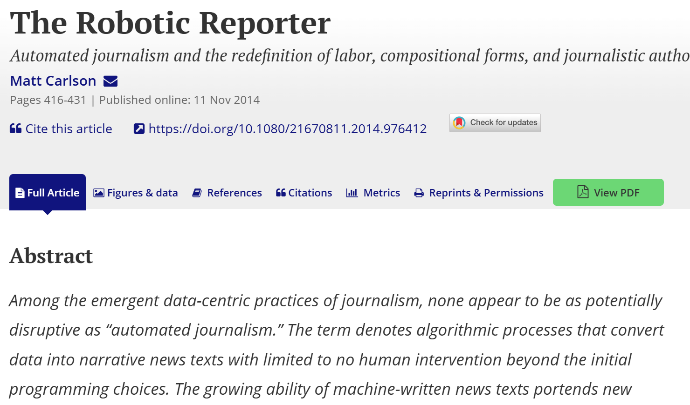
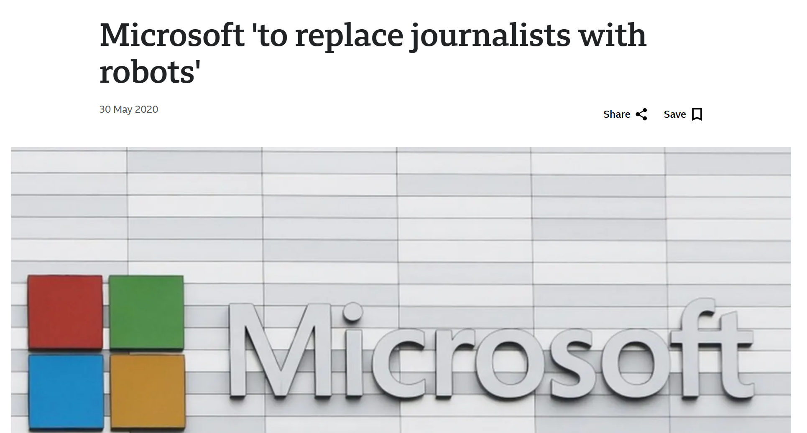

---

## Pre-Production

### Storytelling and Creative Ideation

- In 2016, an IBM  [composed a 6-minute movie trailer](https://www.youtube.com/watch?v=gJEzuYynaiw) for the horror film "Morgan" by training from 100 trailers

- 2024, "Dramatron" scaffol Narrative, character and scene generation (LLM + planning).  

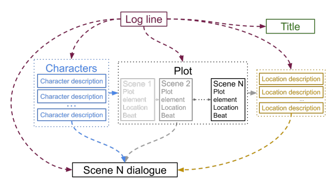

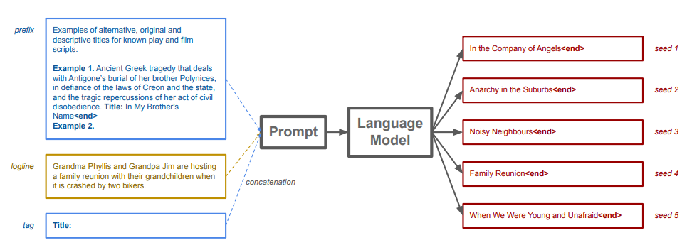

---

<table class="ai-map" style="width:100%; table-layout:fixed; border-collapse:collapse; text-align:left; font-size:0.9em; --col-pre:.5; --col-pro:.5; --col-post:.5; --col-dist:.5;">
  <thead>
    <tr>
      <th style="width:15%; border-bottom:1px solid #ddd;">Phase</th>
      <th style="width:21%; border-bottom:1px solid #ddd;">Pre-production</th>
      <th style="width:21%; border-bottom:1px solid #ddd;">Production</th>
      <th style="width:21%; border-bottom:1px solid #ddd;">Post-production</th>
      <th style="width:21%; border-bottom:1px solid #ddd;">Distribution</th>
    </tr>
  </thead>
  <tbody>
    <tr>
      <td><strong>Owens Activities</strong></td>
      <td>Ideation Scripting Planning Scheduling</td>
      <td>Acquisition Studio/field ops Live/remote workflows</td>
      <td>Editing Adaptation Localization</td>
      <td>Packaging Recommendations Personalization Advertising</td>
    </tr>
    <tr>
      <td><strong>AI Applications</strong></td>
      <td><strong class="green">Automated Journalism  Storytelling & creative ideation Colorization of archives</strong>
      <td><strong class="green"> Camera automation (e.g. framing) Live event analysis (e.g., tracking and overlays)</strong></td>
      <td><strong class="green">???</strong></td>
      <td><strong class="green">???</strong></td>
    </tr>
  </tbody>
</table>

---

## Production

### Camera automation (e.g. framing)

- Auto-framing and re-framing guided by face/talent tracking.  
- Shot-type suggestions (wide, medium, close-up) to support operators.  

### Live event analysis (e.g., tracking and overlays)

- On-screen graphics from CV and telemetry (speed, heatmaps, zones).  
- Real-time profanity/graphic content flags for compliance chains.

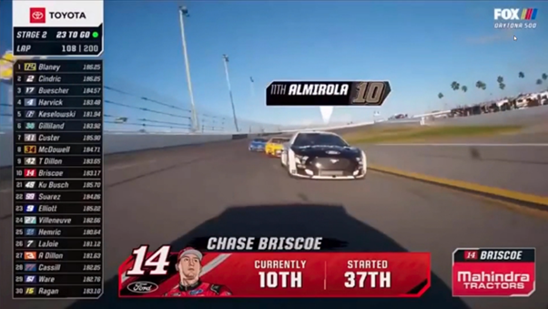
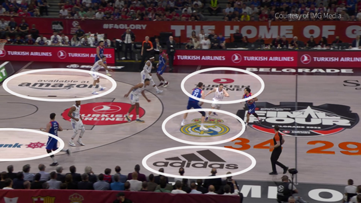

---

<table class="ai-map" style="width:100%; table-layout:fixed; border-collapse:collapse; text-align:left; font-size:0.9em; --col-pre:.5; --col-pro:.5; --col-post:.5; --col-dist:.5;">
  <thead>
    <tr>
      <th style="width:15%; border-bottom:1px solid #ddd;">Phase</th>
      <th style="width:21%; border-bottom:1px solid #ddd;">Pre-production</th>
      <th style="width:21%; border-bottom:1px solid #ddd;">Production</th>
      <th style="width:21%; border-bottom:1px solid #ddd;">Post-production</th>
      <th style="width:21%; border-bottom:1px solid #ddd;">Distribution</th>
    </tr>
  </thead>
  <tbody>
    <tr>
      <td><strong>Owens Activities</strong></td>
      <td>Ideation Scripting Planning Scheduling</td>
      <td>Acquisition Studio/field ops Live/remote workflows</td>
      <td>Editing Adaptation Localization</td>
      <td>Packaging Recommendations Personalization Advertising</td>
    </tr>
    <tr>
      <td><strong>AI Applications</strong></td>
      <td><strong class="green">Automated Journalism  Storytelling & creative ideation Colorization of archives</strong>
      <td><strong class="green"> Camera automation (e.g. framing) Live event analysis (e.g., tracking and overlays)</strong></td>
      <td><strong class="green">Super-resolution & upscaling Colour enhancement & Denoising Synthetic media generation (e.g., actors)</strong></td>
      <td><strong class="green">???</strong></td>
    </tr>
  </tbody>
</table>

---

## Post-Production

### Super-resolution & upscaling

- Temporal SR from SD/HD → UHD/8K with detail preservation.  

### Colour enhancement & Denoising

- Auto color-match across shots.  
- Noise/deblock reduction prior to mezzanine encoding.  

### Synthetic media generation (e.g., actors)

- Background replacement, inpainting, de-aging and re-timing.  

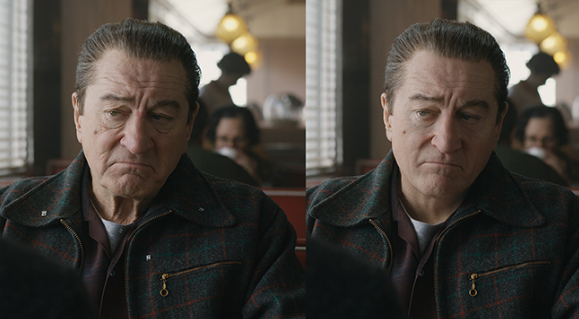

---

<table class="ai-map" style="width:100%; table-layout:fixed; border-collapse:collapse; text-align:left; font-size:0.9em; --col-pre:.5; --col-pro:.5; --col-post:.5; --col-dist:.5;">
  <thead>
    <tr>
      <th style="width:15%; border-bottom:1px solid #ddd;">Phase</th>
      <th style="width:21%; border-bottom:1px solid #ddd;">Pre-production</th>
      <th style="width:21%; border-bottom:1px solid #ddd;">Production</th>
      <th style="width:21%; border-bottom:1px solid #ddd;">Post-production</th>
      <th style="width:21%; border-bottom:1px solid #ddd;">Distribution</th>
    </tr>
  </thead>
  <tbody>
    <tr>
      <td><strong>Owens Activities</strong></td>
      <td>Ideation Scripting Planning Scheduling</td>
      <td>Acquisition Studio/field ops Live/remote workflows</td>
      <td>Editing Adaptation Localization</td>
      <td>Packaging Recommendations Personalization Advertising</td>
    </tr>
    <tr>
      <td><strong>AI Applications</strong></td>
      <td><strong class="green">Automated Journalism  Storytelling & creative ideation Colorization of archives</strong>
      <td><strong class="green"> Camera automation (e.g. framing) Live event analysis (e.g., tracking and overlays)</strong></td>
      <td><strong class="green">Super-resolution & upscaling Colour enhancement & Denoising Synthetic media generation (e.g., actors)</strong></td>
      <td><strong class="green"> Recommendation  AI assistants   Targeted Advertisements  Multilingual & Adaptation</strong></td>
    </tr>
  </tbody>
</table>

---

## Distribution

### Recommendation

- Hybrid recommenders (content + behavior) to mitigate cold-start.  
- Moment-level retrieval (faces/objects/topics) to power semantic search.  
- Diversification
- Measurement fatigue control.

### AI assistants

- Natural-language queries over catalogs (“the episode where…”).  
- Conversational browsing; hands-free accessibility features.  

### Targeted Advertisements

- Contextual + audience-based decisioning with brand-safety filters.  
- Creative optimization (A/B/n) and attention/quality signals.  

---

# Distribution

## Multilingual & Adaptation (e.g., dubbing)

- ASR-driven captioning and automatic timing.  
- Machine dubbing with licensed voices; lip-sync and prosody control.  
- Style-preserving translation
- Example: [TrueSync on the movie "Fall"](https://www.youtube.com/watch?v=iQ1OPpj8gPA)

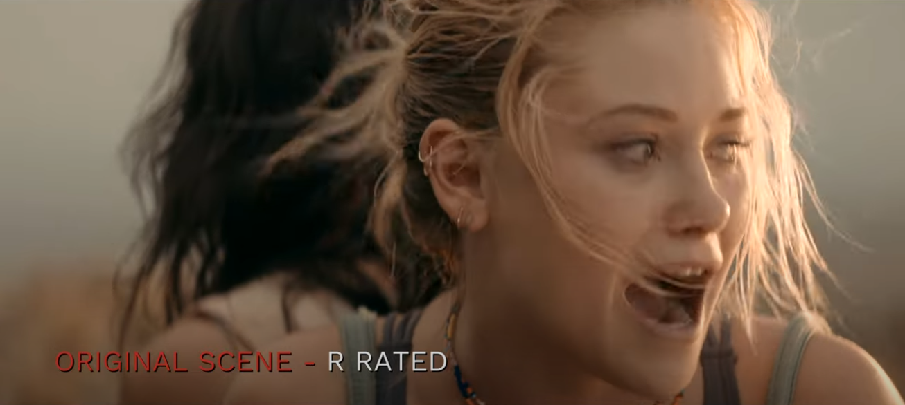
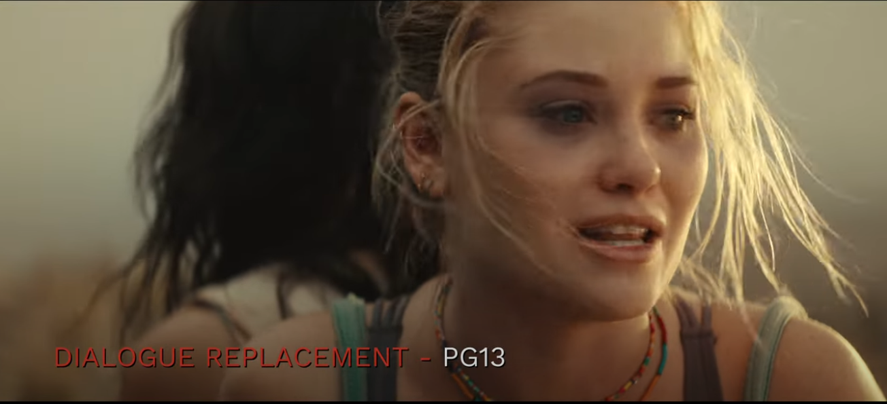
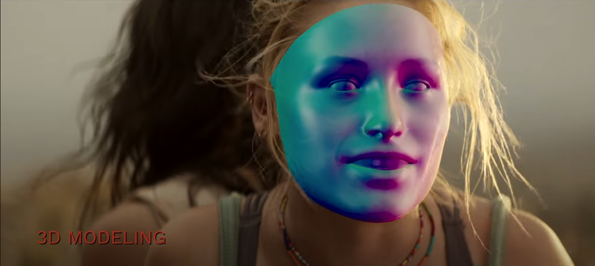
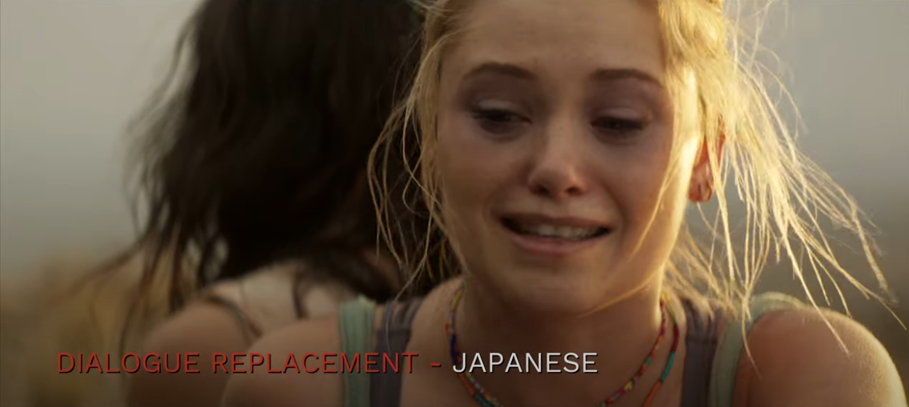

---

<!-- _class: invert -->
<!-- _paginate: false -->

# Final Remarks

---

# Final Remarks

## Owens' TV Workflow can be a usefull perspective to understand AI in TV industry

## AI adoption in TV Industry is uneven  

- **Mature** in *distribution* (recommendations, ads) and *post-production* (enhancement, localization),  
- **Exploratory** in *pre-production* and *production*.  
  - potential for integrated AI within human editorial and technical decision-making.

---

# Opportunities for Researchers

### TV industry high profit and competitive market, so very cloded

### Academic can promote

- **open, reproducible evaluation frameworks and shared testbeds** .  
- **interdisciplinary collaboration**

- **Benchmarks and datasets** specific to broadcast and media workflows.  
  - **Interoperability & metadata standards**  
  - **Quality metrics** for aesthetics, accessibility, and editorial integrity.
- **bias-free human–AI collaboration** in creative/editorial decision-making and its evaluation.  

---

<!-- _class: invert -->
<!-- _backgroundColor: #46afa0 -->
<!-- _paginate: skip -->

# Thank you

Alan Guedes, `a.guedes@reading.ac.uk`
